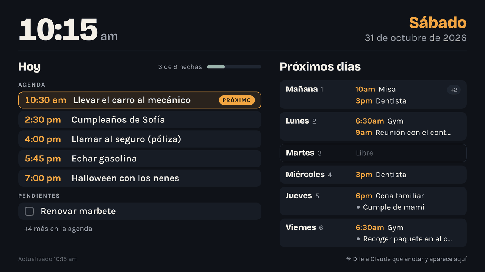

# Mi Agenda

Tu calendario personal de tareas y citas. Lo anotas desde el celular (o le dices
a Claude que lo anote), y lo ves en grande en la TV.

Tiene tres partes, y todas usan los mismos datos:

| Dónde | Dirección | Para qué |
| --- | --- | --- |
| Celular / computadora | `https://TU-SITIO.vercel.app/agenda/` | Ver el mes, anotar, marcar como hecho, editar, y hablar con Claude |
| TV | `https://TU-SITIO.vercel.app/tv` | Reloj grande, lo de hoy y los próximos 6 días. Se actualiza solo cada minuto |
| App de Claude | `https://TU-SITIO.vercel.app/api/mcp?key=TU-CONTRASEÑA` | Conector para preguntarle o pedirle cosas a Claude desde cualquier chat |

## Activarla (una sola vez)

La agenda vive en el mismo proyecto de Vercel que el chatbot, y usa la misma base
de datos Redis y la misma `ANTHROPIC_API_KEY`. Solo falta:

1. En Vercel: **Project Settings → Environment Variables**, agrega
   `AGENDA_PASSWORD` con una contraseña larga que no uses en otro lado.
   (Opcional: `AGENDA_TZ` si no estás en Puerto Rico, ej. `America/New_York`.)
2. Haz **Redeploy** para que tome la variable.
3. Abre `https://TU-SITIO.vercel.app/agenda/` y entra con esa contraseña.

En el celular, usa "Agregar a pantalla de inicio" para tenerla como una app.

## Verla en la TV

Cualquier cosa con un navegador sirve. De más fácil a más confiable:

1. **El navegador de tu Smart TV** (Samsung, LG, etc.): abre `TU-SITIO.vercel.app/tv`,
   escribe la contraseña una vez y queda guardada. Con el botón OK del control
   la pones en pantalla completa.
2. **Fire TV Stick o Chromecast con Google TV**: instala un navegador (Silk en Fire TV)
   y haz lo mismo. Es la opción barata si tu TV no tiene buen navegador.
3. **Una mini PC, Raspberry Pi o laptop vieja conectada por HDMI**: lo mejor si la
   quieres prendida todo el día como un tablero. Abre el link de TV que te da la
   app (botón **📺 TV y Claude**) en modo kiosco, por ejemplo:
   `chromium --kiosk "https://TU-SITIO.vercel.app/agenda/tv.html#k=TU-CONTRASEÑA"`

La vista de TV mueve todo unos píxeles cada 10 minutos para no marcar la pantalla,
y pide al navegador que no apague la pantalla.

## Usarla con Claude

**Dentro de la agenda:** en la barra de abajo escríbele como si fuera una libreta:

- "mañana a las 3 dentista y comprar leche"
- "todos los lunes de noviembre gym a las 6:30"
- "ya pagué la luz" / "mueve lo del dentista al viernes"
- "¿qué tengo esta semana?"

**Desde la app de Claude (celular o computadora):**

1. En la agenda toca **📺 TV y Claude** y copia la URL del conector.
2. En Claude: **Configuración → Conectores → Agregar conector personalizado**,
   ponle de nombre "Mi Agenda" y pega la URL.
3. En cualquier chat: "¿Qué tengo hoy?", "Anota para el martes llamar al banco".

Lo que Claude anote aparece en la TV en menos de un minuto.

> Los links de TV y del conector llevan tu contraseña: no los compartas. Si se
> filtra, cambia `AGENDA_PASSWORD` en Vercel y vuelve a entrar.

## Cómo está hecha

- `agenda/index.html`, `app.js`: la app (mes + día + barra de Claude).
- `agenda/tv.html`, `tv.js`, `tv.css`: la vista de TV, solo lectura.
- `api/agenda.js`: guardar, leer, editar y borrar (protegido con `AGENDA_PASSWORD`).
- `api/agenda-claude.js`: el asistente de la barra; Claude usa las herramientas de la agenda.
- `api/mcp.js`: el conector para la app de Claude (las mismas herramientas).
- `lib/agenda.js`, `lib/agenda-tools.js`: la lógica compartida. Cada mes se guarda
  en Redis como `agenda:mes:AAAA-MM`.
